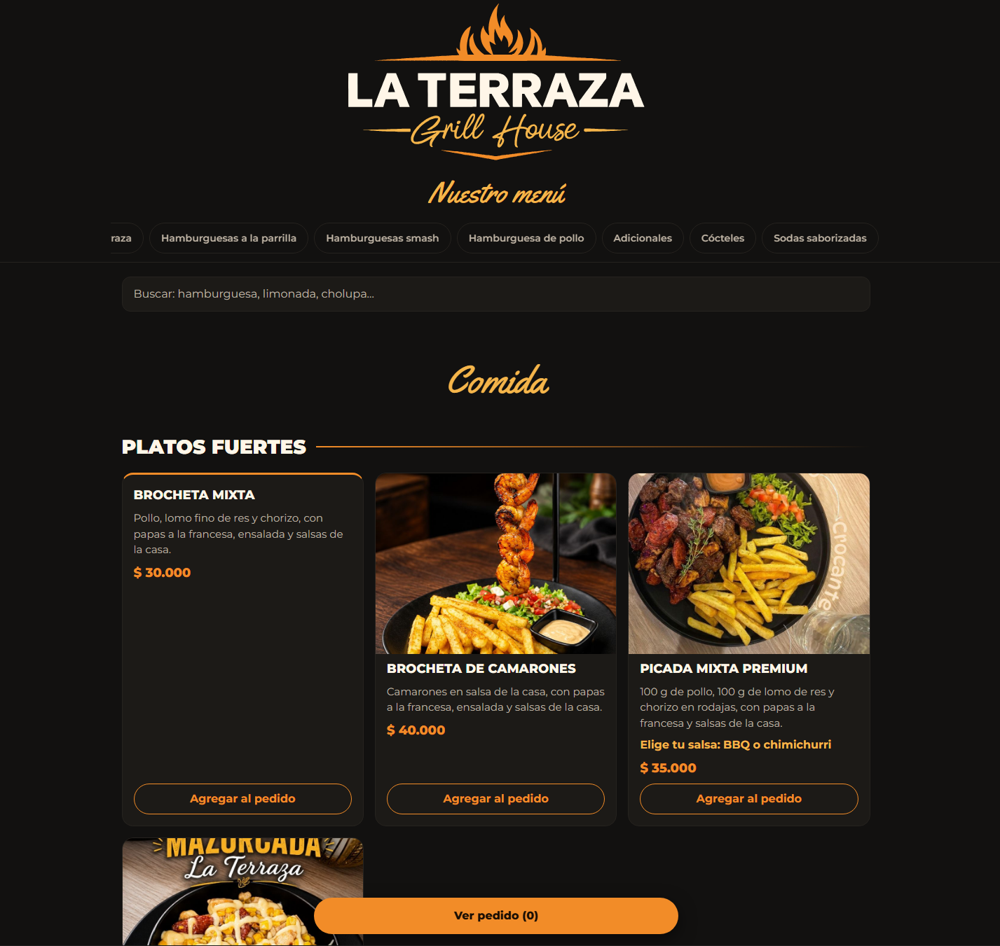

# LA TERRAZA GRILL HOUSE

Es un sitio web para el restaurante con panel de pedido y envío a WhatsApp

## LINK

## CAPTURA

## FUNCIONALIDADES

En La Terraza Grill House puedes buscar el plato que desees, tiene la opción de agregar al pedido y finalizar la compra por WhatsApp.

## TECNOLOGÍAS

HTML, CSS y TypeScript

## ¿CÓMO EJECUTARLO?

Clonar el repositorio y correr "tsc".

## EXPERIENCIA

- Construí el flujo completo del pedido: agregar, quitar y guardar en el localStorage.
- Creé un panel de pedido flotante que se abre y se esconde.
- Agregué un fondo oscuro que al tocarlo cierra el panel del pedido.
- Dibujé los platos con tarjetas y filas desde los datos.
- Buscador por secciones.

## LO QUE HARÍA DESPUÉS

- Opción de eligir pan o patacón para la hamburguesa.
- Opción de elegir salsas de acompañamiento.
- Un textarea para notas del usuario.
- Panel de administrador con base de datos y servidor.
